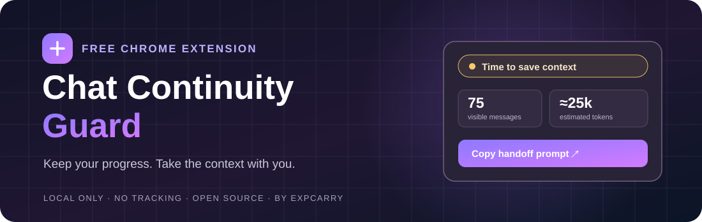

  

  
<strong>A tiny, privacy-first Chrome & Opera extension for long ChatGPT conversations.</strong>

  

    
    
    
    
  

  **[Features](#features) · [Install](#installation) · [Limitations](#important-limitations) · [Privacy](#privacy--permissions) · [Русский](README_RU.md)**

---

## Don't lose the thread

Ever worked through dozens of messages on an important task and worried about losing context when you switch chats?

**Chat Continuity Guard** is a lightweight browser extension that estimates the size of the *currently visible conversation*, warns you at configurable thresholds, and helps you prepare a handoff to a fresh ChatGPT chat.

It is intentionally simple: **no account, no API key, no analytics, no remote server, and no subscription.**

## Features

- **Early warnings** based on visible message count or estimated text tokens.
- **One-click handoff prompt** that asks ChatGPT for a detailed, self-contained project summary.
- **Export visible chat to Markdown** for local reference.
- **Adjustable thresholds** — defaults to 70 messages / ~50,000 estimated tokens.
- **English and Russian interface** based on browser language (Ukrainian-language browsers use the Russian translation for now).
- **Works on `chatgpt.com`** in Chrome and Opera.

## Installation

Chrome Web Store publication is **not available yet**. Install from source:

1. Click **Code → Download ZIP** above (or clone this repository).
2. Extract the ZIP into a folder you intend to keep.
3. Open **`chrome://extensions`** in Chrome or **`opera://extensions`** in Opera.
4. Turn on **Developer mode**.
5. Click **Load unpacked** and select the repository folder containing **`manifest.json`**.
6. Open or refresh a conversation at `https://chatgpt.com/c/...`.
7. Use the small floating indicator at the bottom-right of the screen.

> **Heads up:** If you download the repository ZIP, select its extracted top-level folder (`chat-continuity-guard-main` or similar). `manifest.json` must be directly inside the folder you choose.

## How it works

1. The content script reads **rendered, visible-page conversation elements** using DOM selectors.
2. A rough text-length heuristic estimates tokens. It is **not** the tokenizer or context-window measurement used by OpenAI.
3. Once a configured threshold is crossed, the pill changes state.
4. **You** decide when to copy the handoff prompt or download the Markdown transcript.
5. Settings are stored locally with Chrome's extension storage.

No internal ChatGPT API interception. No background network requests. No chat content is uploaded by this extension.

## Important limitations

**This is *not* an accurate ChatGPT context-window meter.** It cannot see your model's actual remaining context, server-side token usage, automatic compaction state, or account message limits. A conversation may become unavailable before the warning, or continue perfectly well afterward.

ChatGPT can virtualize older messages; attachments, images, non-rendered tool outputs, and hidden content may not appear in the DOM. Consequently, **both the count and Markdown export can be incomplete**. Keep critical work in proper project files rather than treating this extension as a guaranteed backup.

DOM selectors can change when ChatGPT updates. If the counter stops working, [open an issue](https://github.com/ExpCarry/chat-continuity-guard/issues) with your browser/version and a screenshot that **does not contain private messages**.

## Privacy & permissions

| Permission | Purpose |
|---|---|
| `storage` | Save two warning thresholds on your device. |
| Access to `https://chatgpt.com/*` | Read conversation elements visible to the current page, display the indicator, and allow manual export. |

There are **no trackers, remote scripts, external requests, analytics SDKs, or paid services**. Export and copy happen only on user clicks. Read the complete [privacy policy](PRIVACY.md).

## Roadmap

- [ ] Clearer handoff packages (task / decisions / artifacts / next action)
- [ ] Per-chat warning dismissal and better progress indicators
- [ ] Support for additional UI languages and new ChatGPT DOM layouts
- [ ] Automated browser compatibility tests against non-private mocked pages
- [ ] Optional import of a previous handoff into a new chat — *only after deliberate user action*

## Contributing

Bug reports, translations, documentation improvements, and pull requests are welcome. Please read [CONTRIBUTING.md](CONTRIBUTING.md) and [SECURITY.md](SECURITY.md). Use synthetic examples, not real conversation contents, when reporting bugs.

## About this project

Created and maintained by **[ExpCarry](https://expcarry.com/)** — a gaming services platform. We built this tool to make long AI-assisted work sessions easier to continue. Visit [ExpCarry.com](https://expcarry.com/) to learn about our main project.

This is an independent community project. **Not affiliated with, endorsed by, or officially supported by OpenAI or ChatGPT.**

Released under the [MIT License](LICENSE). Copyright © 2026 ExpCarry.
